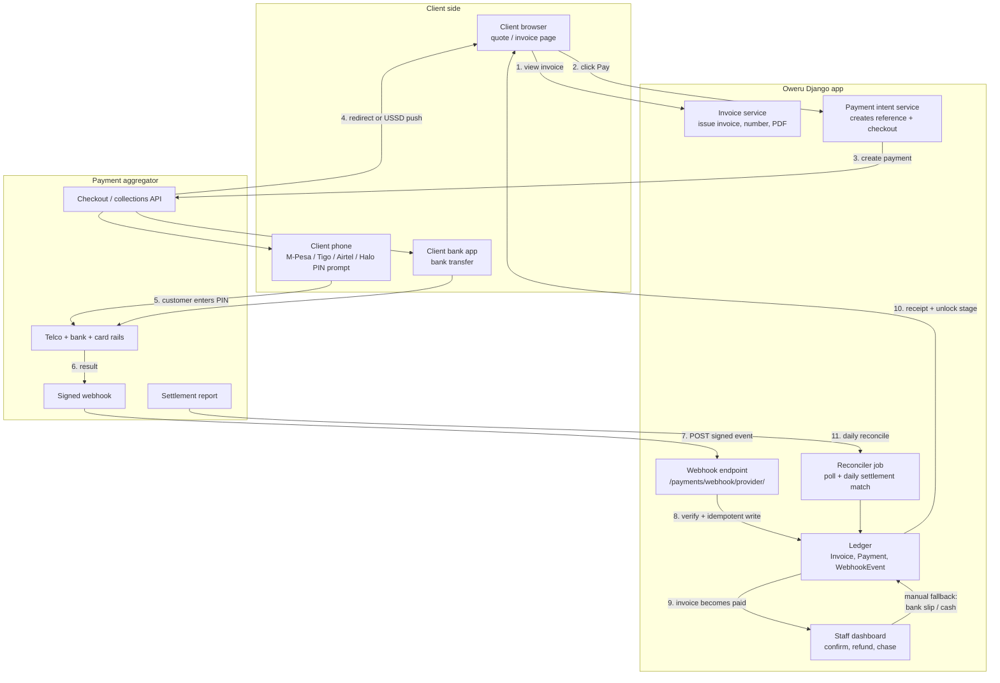
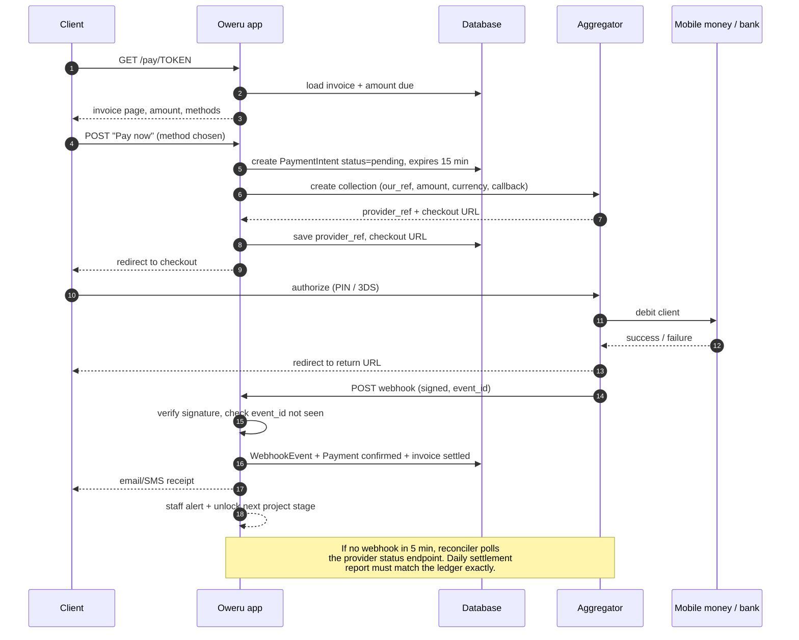
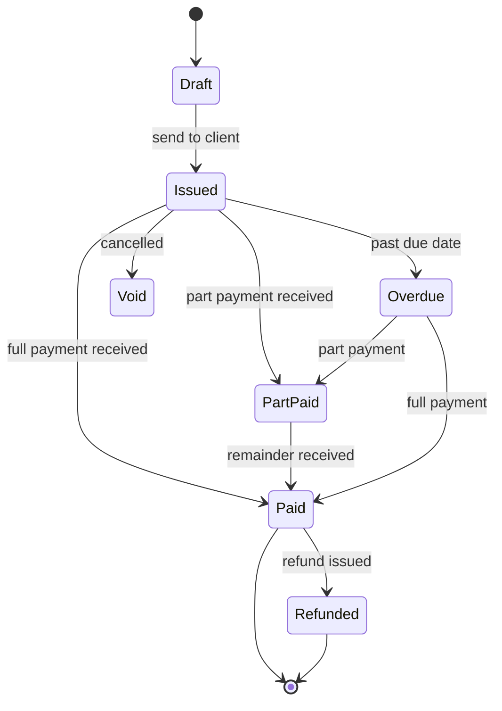

# Oweru Tech — Payment Flow Recommendation

> Goal: take money reliably, with the least friction for a Tanzanian client, and
> without letting unpaid work walk out the door.

---

## 1. The recommendation in one line

**Invoice-first, hosted checkout, webhook-confirmed, milestone-based.**

- The **invoice** is the source of truth — not the customer's screenshot.
- The customer pays through a **hosted checkout page** from a local aggregator
  (mobile money first, card second) instead of sending money to a till number.
- The system confirms payment from a **signed webhook**, not from a human reading
  an SMS.
- Money is collected in **3 milestones**: 50% deposit, 30% at staging, 20% at go-live.
- The existing manual "I have paid, here is my reference" form stays as a
  **fallback** for bank slips and cash — never as the primary path.

Your app already models most of this (`Enquiry`, `Proposal`, `Payment`,
`payment_status`, tokens, notifications). This design upgrades it rather than
replacing it.

---

## 2. Why this flow and not the alternatives

| Option | Problem |
|---|---|
| Customer sends to a personal/till number and uploads a screenshot | You must trust a screenshot. No automatic reconciliation. Chargebacks and fake SMS are common. Does not scale past a few jobs/month. |
| Card-only gateway | Most TZS clients do not hold a card with international limits. High decline rate. |
| Mobile-money-only, manual | Fine for small jobs, but no audit trail, no partial payments, no receipts. |
| **Hosted checkout via a TZ aggregator** | One integration covers M-Pesa, Tigo Pesa, Airtel Money, HaloPesa, bank and card. Signed webhooks. Settlement report for reconciliation. **This is the pick.** |

### Provider shortlist (Tanzania)

| Provider | Mobile money | Cards | Bank | Hosted page | Webhooks | Notes |
|---|---|---|---|---|---|---|
| **ClickPesa** | ✅ | ✅ | ✅ | ✅ | ✅ | Best developer API, clean payment links, good sandbox. **Primary pick.** |
| **Azampay** | ✅ | ✅ | ✅ | ✅ | ✅ | Strong USSD push across all four telcos. Good second choice. |
| **Selcom** | ✅ | ✅ | ✅ | ✅ | ✅ | Largest local reach, stricter onboarding. |
| **Pesapal** | ✅ | ✅ | ✅ | ✅ | ✅ (IPN) | Long-established, TZ-origin. |
| **Flutterwave** | ✅ | ✅ | ⚠️ | ✅ | ✅ | Regional; useful if you take USD/KES too. |

**Pick one primary (ClickPesa) and keep one standby (Azampay).** Two live
integrations doubles the reconciliation work for no benefit. Fees in this market
are typically ~1.5–3.5% for mobile money and ~3–4% for cards, with settlement
around T+1 to T+2 — confirm current rates and settlement terms in writing before
you sign, because they change.

---

## 3. Block diagram — the whole system



### The same flow in plain text

```
CLIENT                OWERU APP                  AGGREGATOR            MONEY RAILS
  |                       |                          |                     |
  |-- view invoice ------>|                          |                     |
  |-- click "Pay 50%" --->|                          |                     |
  |                       |-- create payment ------->|                     |
  |                       |   our_ref + amount       |                     |
  |<-- checkout URL ------|<-- checkout URL ---------|                     |
  |-- authorize (PIN) ---------------------------------------------------> |
  |                       |                          |<-- result ----------|
  |                       |<-- signed webhook -------|                     |
  |                       |-- verify signature       |                     |
  |                       |-- write Payment + ledger |                     |
  |<-- receipt + unlocked |                          |                     |
  |    project stage      |                          |                     |
```

---

## 4. Sequence diagram — one deposit payment



---

## 5. Milestone schedule (what to invoice and when)

| # | Invoice | % | Trigger | What it unlocks |
|---|---|---|---|---|
| 1 | Deposit | 50% | Quote accepted / signed | Slot booked, discovery starts |
| 2 | Milestone | 30% | Staging link approved by client | Production build, content load |
| 3 | Balance | 20% | Go-live sign-off | Handover: repo, hosting, admin accounts |

- Small packages under TZS 1,000,000 → **50 / 50** is fine (deposit + delivery).
- Care plans → **monthly subscription invoice**, auto-issued on the 1st, with
  dunning (reminder day 3, suspend day 10).
- Never split below 20% — each invoice costs you reconciliation effort.

---

## 6. Status machine (put this in the database, not in your head)



`Payment` itself keeps three states only: `pending → confirmed` or
`pending → rejected`. Confirmation is what moves the invoice.

---

## 7. Data model to add (small, surgical)

You already have `Payment`. Add these around it:

```python
class Invoice(models.Model):
    number            # INV-2026-0042, generated, never reused
    enquiry / proposal
    kind              # deposit | milestone | balance | subscription
    amount, currency  # Decimal, TZS default
    due_date
    status            # draft | issued | part_paid | paid | overdue | void | refunded
    pdf_file          # generated once, stored

class PaymentIntent(models.Model):
    invoice
    our_reference     # unique, sent to provider AND shown to client
    provider, provider_reference
    amount, currency
    checkout_url
    status            # created | pending | succeeded | failed | expired
    expires_at        # 15 minutes
    idempotency_key   # unique

class WebhookEvent(models.Model):
    provider
    event_id          # unique -> makes replay harmless
    payload           # raw JSON, immutable
    signature_valid
    processed_at
    result            # ok | ignored | error

class Settlement(models.Model):
    provider, period_start, period_end
    gross, fees, net, payout_reference
```

Extend `Payment` with: `provider`, `provider_txn_id` (unique), `settled_at`,
`fee_amount`, `net_amount`, `webhook_event`. Then
`Enquiry.sync_payment_status()` keeps working unchanged.

---

## 8. Rules that prevent 90% of payment bugs

1. **Never trust the client.** Amount comes from the invoice row, never from the
   form or the provider callback. Compare provider amount to invoice amount.
2. **Verify the webhook signature** before parsing, and **allowlist provider IPs**.
   A public webhook URL is scanned constantly.
3. **Idempotent writes.** `event_id` unique + `provider_txn_id` unique. Providers
   retry; retries must be harmless.
4. **Always answer 200 fast**, then process. Do not do PDF generation or email
   inside the webhook request.
5. **Payment intents expire.** 15 minutes. Otherwise stale Pending rows pile up.
6. **Manual confirm is a separate, audited action** — it already is (`confirmed_by`,
   `date_confirmed`). Keep proof images attached to the `Payment`.
7. **Daily reconciliation is mandatory.** Match provider settlement net against
   your ledger. Anything unmatched goes to an "unmatched payments" queue.
8. **Refunds are new records**, not deleted payments. Credit note + negative
   payment row.
9. **One currency per invoice.** Convert USD quotes at quote time and freeze the
   rate on the invoice.
10. **Watch telco limits.** Mobile money has daily per-transaction and per-day caps
    that can be below a large deposit. If the amount exceeds the cap, offer a
    **split payment** (two intents) or bank transfer.

---

## 9. Failure cases and what the system does

| Situation | System behaviour |
|---|---|
| Client closes the checkout page | Intent expires in 15 min; invoice stays `issued`; client can retry with the same link |
| Client pays but webhook is delayed | Reconciler polls provider every 5 min, then every 30 min, for 24 h |
| Webhook arrives twice | `event_id` unique → second one acknowledged and ignored |
| Webhook signature invalid | 400, logged in `WebhookEvent` as `signature_valid=false`, staff alerted |
| Amount mismatch | Payment stored as `pending` with a mismatch flag; never auto-confirms |
| Client pays twice | Second payment is `pending` with reason `duplicate`; refund flow |
| Client sends a bank slip instead | Existing manual claim page → staff confirms → same ledger |
| Provider is down | Show bank transfer + manual claim path automatically |
| Settlement is short (fees) | `fee_amount` recorded on Payment; invoice still settles at gross |

---

## 10. Rollout plan

**Phase 1 — invoicing (1–2 days).** `Invoice` model, numbering, PDF, emailed
payment link that reuses today's `/pay/<token>/` page. No provider yet. This alone
makes you look professional and removes the "how much do I pay?" conversation.

**Phase 2 — one live provider (3–5 days).** Sandbox first. Hosted checkout,
webhook endpoint, `PaymentIntent`, `WebhookEvent`, idempotency, email/SMS receipt.
Manual claim stays as fallback.

**Phase 3 — reconciliation (2–3 days).** Nightly poll for stuck intents, daily
settlement import, unmatched queue in the staff dashboard, refunds.

**Phase 4 — automation (3–4 days).** Auto-unlock project stages, auto-issue care
plan invoices, dunning reminders, WhatsApp/SMS nudges, revenue dashboard.

---

## 11. What I would build first

`Invoice` + `PaymentIntent` + the webhook endpoint. Everything else is polish.
If the ledger and the webhook are correct, the rest can be added without touching
money-handling code again — and that is the only part you cannot afford to get
wrong twice.

---

### Short answer to "which one should we use?"

**ClickPesa hosted checkout, mobile money first, card second, webhook-confirmed,
50/30/20 milestones, with your existing manual claim page as the bank-slip and
cash fallback.**
